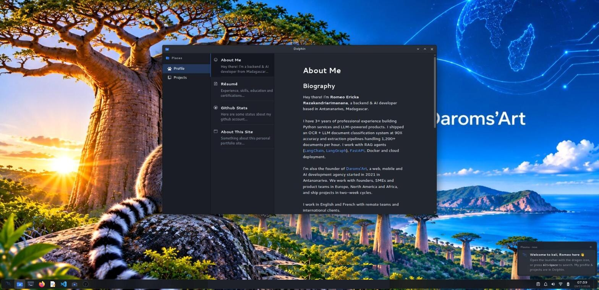

# portfolio-kali

Interactive portfolio of **Romeo Ericka Razakandriarimanana** (Backend & AI Developer), styled as **Kali Linux** running the **KDE Plasma** desktop.

- 🌐 Live: [portfolio.daromsart.xyz](https://portfolio.daromsart.xyz/)
- 🏢 Agency: [daromsart.xyz](https://daromsart.xyz/)
- 🐙 GitHub: [@daromsartof](https://github.com/daromsartof)
- 💼 LinkedIn: [daroms](https://www.linkedin.com/in/daroms/)

Powered by [React](https://reactjs.org/) + [Zustand](https://zustand-demo.pmnd.rs/) + [UnoCSS](https://uno.antfu.me/) + [TypeScript](https://www.typescriptlang.org/) + [Vite](https://vitejs.dev/).

Forked from [Renovamen/playground-macos](https://github.com/Renovamen/playground-macos) and reskinned from macOS to Kali Linux / KDE Plasma.




&nbsp;

## Features

- **LightDM-style login** screen with the Kali dragon, power menu and live clock.
- **GRUB menu → Plymouth splash** boot sequence.
- **KDE Plasma panel** (bottom): Kickoff application launcher, icons-only task
  manager, and a system tray — clipboard, notifications, audio, network,
  battery, and a digital clock with a calendar popup.
- **KRunner** quick search — press `Alt`+`Space` (or `Alt`+`F2`).
- **KWin / Breeze** dark window decorations, with the buttons on the right.
- Apps reskinned to their KDE / Kali counterparts:
  - **Dolphin** — file manager holding my profile, résumé and projects
  - **Konsole** — terminal with Kali's zsh prompt
  - **Firefox ESR** — browser with my links
  - **Kate** — markdown editor
  - **Visual Studio Code** · **Kamoso** (camera)


&nbsp;

## Usage

Clone the repo and install dependencies:

```bash
pnpm install
```

Start dev server (with hot reloading):

```bash
pnpm dev
```

Build for production with minification to the `dist` folder:

```bash
pnpm build
```


&nbsp;

## Credits

- [Kali Linux](https://www.kali.org/) and the [KDE Plasma](https://kde.org/plasma-desktop/) desktop (design inspiration)
- Original macOS version: [Renovamen/playground-macos](https://github.com/Renovamen/playground-macos)
- UI icons from [Iconify](https://iconify.design/) (Material Design Icons & Simple Icons)


&nbsp;

## License

[MIT](LICENSE)
